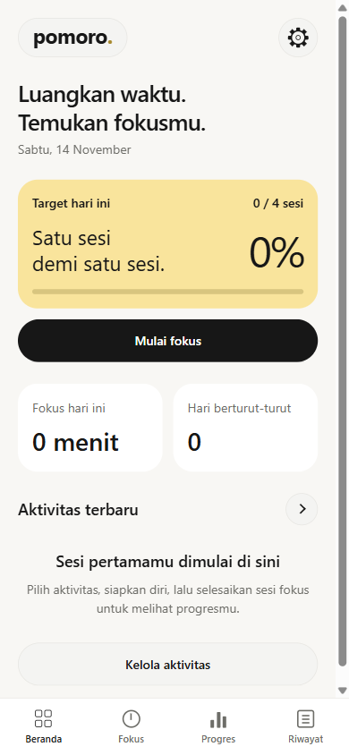
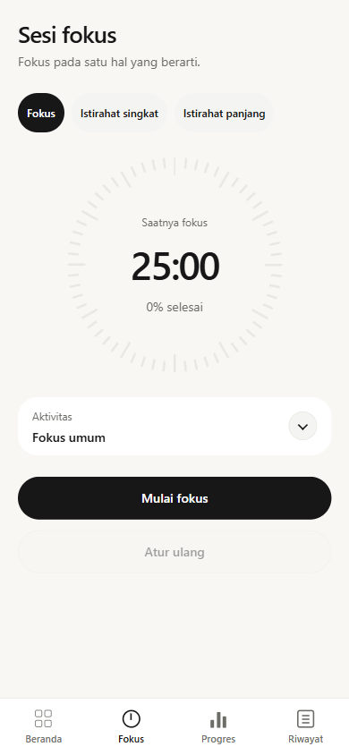
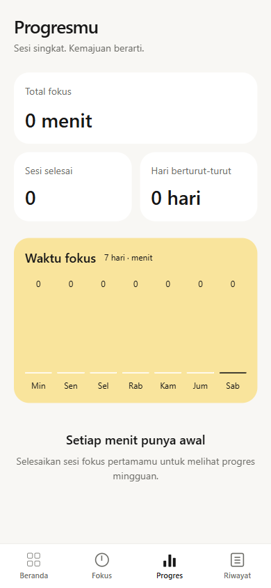
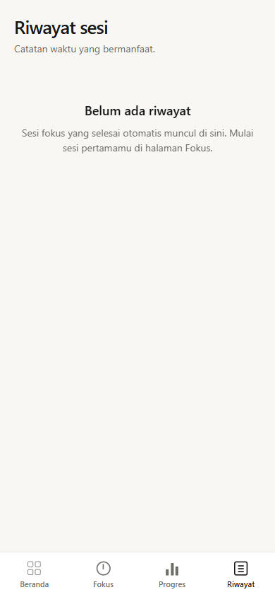
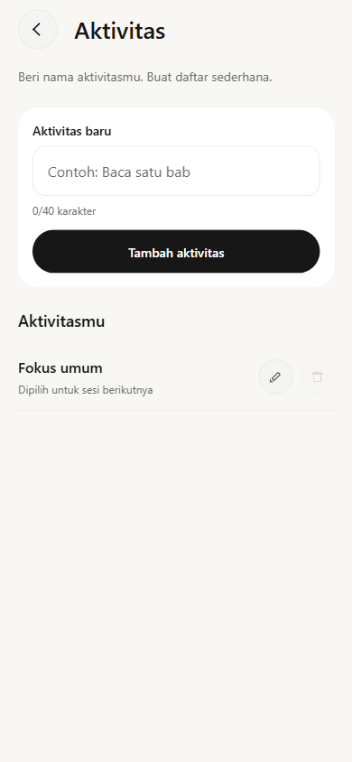
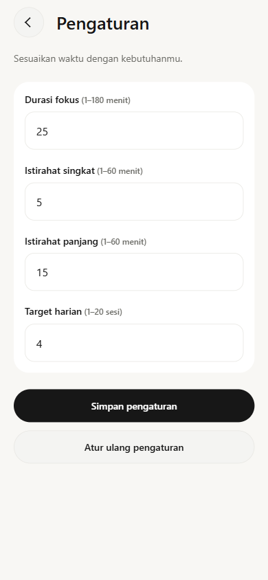

<p align="center">
  
</p>

<h1 align="center">Pomoro</h1>

<p align="center">Aplikasi pengatur waktu fokus dan belajar Pomodoro yang sederhana dan bebas distraksi.</p>

<p align="center">
  <a href="https://reactnative.dev/"></a>
  <a href="https://expo.dev/"></a>
  <a href="https://reactnative.dev/"></a>
  <a href="https://www.typescriptlang.org/"></a>
  <a href="LICENSE"></a>
</p>

<p align="center">
  <strong>Disusun Oleh:</strong><br>
  Nama: Muhamad Dikrulloh<br>
  NIM: 2430511076<br>
  Kelas: 5B
</p>

Saat belajar atau mengerjakan tugas, kita sering kali mudah teralihkan oleh notifikasi dan membuka aplikasi lain di ponsel. **Pomoro** dibuat untuk membantumu membangun kebiasaan belajar yang lebih teratur menggunakan teknik Pomodoro. Dengan tampilan yang bersih, tenang, dan tanpa dekorasi berlebihan, Pomoro membantumu fokus menyelesaikan satu hal demi satu hal secara nyaman—semua data tersimpan langsung di ponselmu tanpa perlu login atau koneksi internet.

---

## Gambaran Umum

Pomoro menerapkan teknik Pomodoro yang membagi waktu belajar ke dalam interval fokus dan waktu istirahat yang teratur:

- **Fokus & Istirahat Terjadwal**: Membantu membagi waktu belajar ke sesi fokus terarah (bawaan 25 menit) yang diselingi istirahat singkat dan panjang agar pikiran tetap segar.
- **Waktu Hitung Mundur Akurat**: Menggunakan patokan waktu nyata (_timestamp_), sehingga timer tetap berjalan tepat meskipun aplikasi diminimalkan (_background_) atau layar ponsel mati.
- **Pencatatan Berdasarkan Aktivitas**: Setiap sesi fokus dapat diberi nama (seperti tugas kuliah, membaca materi, atau latihan koding) agar kamu tahu ke mana waktumu dihabiskan.
- **Pantau Target dan Kebiasaan**: Menampilkan capaian target sesi harian, total waktu fokus, dan hari aktif berturut-turut (_streak_) secara langsung dari riwayat belajarmu.

## Fitur Utama

- **Timer Fokus Pomodoro**: Timer hitung mundur yang mudah digunakan dengan tombol mulai, jeda, lanjutkan, dan atur ulang. Tampilan dial melingkar 60 titik menunjukkan sisa waktu dan persentase sesi secara jelas.
- **Siklus Istirahat Otomatis**: Setelah sesi fokus selesai, aplikasi otomatis menyarankan istirahat singkat (5 menit). Setelah menuntaskan 4 sesi fokus, kamu akan diarahkan untuk mengambil istirahat panjang (15 menit).
- **Kelola Aktivitas & Subjek**: Tambah, ubah, atau hapus nama aktivitas fokus sesuai kebutuhan belajarmu dengan batas nama hingga 40 karakter.
- **Target Harian**: Tentukan berapa sesi fokus yang ingin dicapai setiap hari. Halaman utama menampilkan persentase dan bar progres yang terisi seiring sesi yang kamu selesaikan.
- **Statistik & Grafik Mingguan**: Lihat total waktu belajar, jumlah sesi yang tuntas, catatan hari berturut-turut, serta grafik batang waktu fokus selama 7 hari terakhir.
- **Riwayat Sesi Lengkap**: Setiap sesi fokus yang selesai otomatis tercatat rapi beserta nama aktivitas, durasi, tanggal, dan jam pengerjaan.
- **Suara Notifikasi**: Bunyi notifikasi penanda dari `expo-audio` yang memberitahu saat sesi fokus atau istirahat selesai ketika aplikasi sedang dibuka.
- **Penyimpanan Lokal Otomatis**: Semua data aktivitas, riwayat sesi, dan preferensi pengaturan langsung tersimpan di penyimpanan perangkat sehingga tidak hilang saat aplikasi ditutup.
- **Pengaturan Waktu Fleksibel**: Bebas menyesuaikan durasi fokus (1–180 menit), istirahat singkat/panjang (1–60 menit), serta target harian dengan opsi kembali ke pengaturan awal kapan saja.

## Tangkapan Layar

<p align="center">
  
  
  
  
</p>

<p align="center">
  
  
</p>

## Teknologi yang Digunakan

| Bagian                   | Teknologi                                                        |
| :----------------------- | :--------------------------------------------------------------- |
| **Framework & Platform** | Expo SDK 58, React Native 0.88, React 19                         |
| **Bahasa Pemrograman**   | TypeScript 6.0                                                   |
| **Navigasi Halaman**     | Expo Router 58                                                   |
| **State Management**     | React Context API & React Hooks                                  |
| **Penyimpanan Lokal**    | AsyncStorage (`@react-native-async-storage/async-storage` 2.2.0) |
| **Audio Suara**          | `expo-audio` 58                                                  |
| **Tata Letak & UI**      | `react-native-safe-area-context` 5.11, `expo-status-bar`         |

## Memulai

### Prasyarat

- [Node.js](https://nodejs.org/) (versi 18.x atau lebih baru) dan `npm`.
- Aplikasi [Expo Go](https://expo.dev/go) di HP Android/iOS, atau emulator Android / simulator iOS di laptop/komputer.

### Cara Menjalankan Aplikasi

1. Kloning repositori ini:

   ```bash
   git clone https://github.com/muhamaddikrulloh/pomoro.git
   cd pomoro
   ```

2. Pasang dependensi yang diperlukan:

   ```bash
   npm install
   ```

3. Jalankan server pengembangan Expo:

   ```bash
   npx expo start
   ```

4. Buka aplikasi sesuai platform pilihanmu:
   - Tekan `a` di terminal untuk membuka di Android emulator / perangkat fisik (`npm run android`).
   - Tekan `i` di terminal untuk membuka di simulator iOS (`npm run ios`).
   - Tekan `w` di terminal untuk membuka di browser web (`npm run web`).
   - Buka aplikasi Expo Go di HP, lalu pindai (_scan_) kode QR yang ada di terminal.

## Struktur Direktori

| Direktori         | Fungsi Utama                                                                                              |
| :---------------- | :-------------------------------------------------------------------------------------------------------- |
| `src/app/`        | Halaman aplikasi dan alur navigasi Expo Router (beranda, fokus, progres, riwayat, pengaturan, aktivitas). |
| `src/components/` | Komponen tampilan yang dipakai berulang kali (dial timer, kartu ringkasan, tombol, input form).           |
| `src/context/`    | Pusat pengelolaan state aplikasi untuk siklus timer, penyimpanan data, dan pesan notifikasi.              |
| `src/hooks/`      | Custom hooks untuk kontrol audio lonceng, deteksi tema, dan skema warna.                                  |
| `src/storage/`    | Modul pembacaan dan penyimpanan data ke AsyncStorage beserta validasinya.                                 |
| `src/utils/`      | Logika murni aplikasi: perhitungan sisa waktu timer, pencatatan sesi, dan kalkulasi statistik.            |
| `src/constants/`  | Token desain visual: palet warna, tipografi, dan jarak padding/margin.                                    |
| `assets/`         | Aset ikon aplikasi, splash screen, dan berkas audio WAV.                                                  |
| `docs/`           | Berkas tangkapan layar antarmuka dan dokumentasi pendukung.                                               |
| `tests/`          | Kumpulan pengujian otomatis untuk menguji timer, riwayat, dan penyimpanan lokal.                          |

## Pengembangan & Pengujian

Sebelum menyimpan atau mengumpulkan pekerjaan, jalankan perintah pengecekan berikut:

```bash
# Cek kesalahan tipe data TypeScript
npm run typecheck

# Cek kerapian kode dengan linter
npm run lint

# Jalankan pengujian logika otomatis
npm test
```

## Kontribusi

Saran perbaikan, laporan kendala (_bug report_), atau ide fitur baru sangat diterima. Silakan buka _issue_ atau kirimkan _pull request_ pada repositori ini.

## Lisensi

Proyek ini bersifat terbuka (_open-source_) di bawah lisensi [MIT License](LICENSE).
